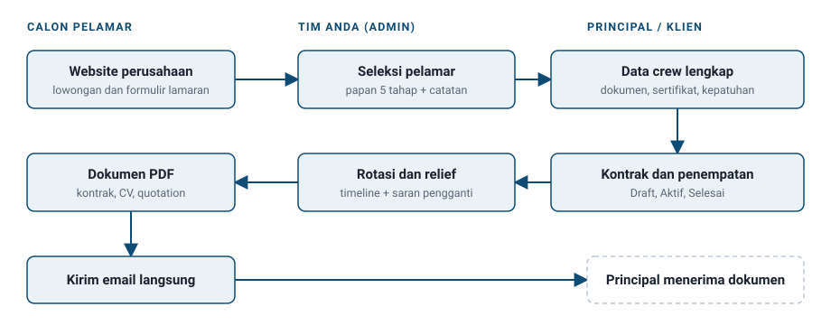
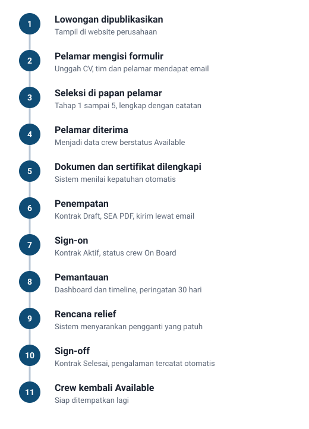

# Proposal Platform Manajemen Crew dan Website Perusahaan Pelayaran

Satu sistem untuk mengelola data pelaut, kontrak, rotasi, dokumen, rekrutmen, dan website perusahaan Anda.

---

## Teknologi di Balik Platform

Platform ini dibangun dengan **Go (Golang)**, bahasa pemrograman modern buatan Google yang dipakai oleh perusahaan-perusahaan teknologi besar untuk sistem yang harus cepat dan andal. Kami memakai **versi terbaru yang aman**, sehingga Anda mendapat perbaikan keamanan dan peningkatan kinerja terkini.

Keuntungannya bagi Anda:

- **Sangat cepat.** Halaman dan data tampil nyaris seketika, bahkan saat banyak orang membuka sistem bersamaan.
- **Hemat sumber daya.** Server berspesifikasi sedang sudah cukup, jadi biaya hosting bulanan tetap rendah.
- **Stabil dan andal.** Sistem tetap berjalan lancar dalam pemakaian harian jangka panjang dan jarang mengalami gangguan.
- **Aman.** Bahasa ini kuat dalam pengelolaan memori dan pengecekan kesalahan, sehingga celah keamanan umum lebih mudah dicegah.
- **Mudah dipasang dan dirawat.** Aplikasi dikemas menjadi satu paket siap jalan, sehingga pemasangan dan pembaruan lebih sederhana.
- **Siap berkembang.** Fondasinya kokoh untuk ditambah fitur dan menampung data yang terus bertambah.

Tampilan panel admin dan website memakai teknologi web modern yang responsif, nyaman di ponsel maupun komputer, dan ramah mesin pencari.

---

## 1. Ringkasan Singkat

Platform ini adalah aplikasi web terpadu untuk **perusahaan manning agency / penyedia awak kapal**. Platform ini menggabungkan dua hal yang biasanya terpisah:

1. **Panel admin** untuk pekerjaan harian: data crew, kontrak, jadwal rotasi, pembuatan dokumen, pengiriman email, dan rekrutmen.
2. **Website perusahaan** yang tampil profesional di depan calon pelamar dan principal. Isinya bisa Anda ubah sendiri dari panel admin, tanpa programmer.

Hasilnya, data tidak lagi tersebar di banyak file Excel, folder, dan chat. Semua tersimpan di satu tempat yang rapi, aman, dan mudah dicari.

---

## 2. Masalah yang Umum Dihadapi

| Masalah sehari-hari | Dampaknya |
| --- | --- |
| Data crew tersebar di Excel, folder, dan WhatsApp | Sulit dicari, mudah hilang, dan sering ada versi ganda |
| Paspor, Seaman Book, dan sertifikat STCW kedaluwarsa tanpa disadari | Crew gagal naik kapal, kontrak tertunda, risiko denda |
| Jadwal pergantian crew (relief) dipantau manual | Pengganti terlambat dicari dan kapal kekurangan crew |
| Kontrak, quotation, dan CV diketik ulang satu per satu | Memakan waktu, rawan salah ketik, format tidak seragam |
| Lamaran masuk lewat email dan WhatsApp tanpa alur | Pelamar bagus terlewat dan tidak ada riwayat seleksi |
| Website sulit diubah dan harus minta bantuan vendor | Informasi lowongan dan berita jadi usang |
| Data sensitif crew (paspor, rekening) disimpan sembarangan | Risiko kebocoran data |

---

## 3. Solusi dalam Satu Gambaran

Satu data crew dipakai di semua tahap. Data tidak perlu diketik ulang.

---

## 4. Fitur Panel Admin

### 4.1 Dashboard: gambaran perusahaan dalam sekali lihat

- Jumlah crew total dan per status: **Available, On Board, Sign Off, Medical Leave, Inactive**.
- Jumlah kontrak aktif.
- **Dokumen dan sertifikat yang akan habis** dalam 30, 60, dan 90 hari, serta yang sudah kedaluwarsa.
- Crew yang **jatuh tempo relief** dalam 30 hari ke depan.
- Pelamar baru dan pesan masuk yang belum dibaca.
- Grafik: crew per status, crew per jabatan, crew per principal, dan sign-on / sign-off per bulan selama 12 bulan terakhir.
- Peringatan otomatis jika backup harian gagal.

### 4.2 Data Master

Daftar acuan yang dipakai semua menu, semuanya bisa diatur sendiri:

- Perusahaan dan principal
- Kapal: nama, nomor IMO, bendera, tipe, GRT, tenaga mesin, dan tahun pembuatan
- Jabatan (Deck, Engine, Catering), tipe kapal, mata uang, status crew
- Jenis tunjangan, jenis dokumen, dan jenis sertifikat

**Matriks Kepatuhan (Compliance Matrix).** Anda menentukan dokumen dan sertifikat apa yang wajib untuk setiap jabatan. Sistem lalu otomatis menilai apakah seorang crew **patuh** atau **belum patuh** untuk jabatan tertentu.

### 4.3 Manajemen Crew

Setiap crew mendapat **ID unik 9 karakter** dan profil lengkap dalam 9 tab:

1. Data pribadi, termasuk foto
2. Kontak dan alamat
3. Rekening bank (bisa lebih dari satu)
4. Keluarga terdekat (next of kin)
5. Dokumen: KTP, paspor, Seaman Book, visa, MCU, dan lainnya, dengan file terunggah
6. Sertifikat STCW
7. Pengalaman berlayar (sea service)
8. Penempatan saat ini
9. Status kepatuhan: daftar periksa otomatis (Valid / Segera habis / Kedaluwarsa / Belum ada)

Hal yang membantu pekerjaan Anda:

- **Lencana warna masa berlaku**: hijau (aman), kuning (61–90 hari), oranye (31–60 hari), merah (0–30 hari), merah tua (sudah kedaluwarsa).
- **Hitung masa berlayar otomatis** per jabatan dan total, tanpa menghitung dua kali periode yang tumpang tindih (contoh: 3 tahun 4 bulan 12 hari).
- **Pencarian cepat** berdasarkan nama, ID crew, nomor paspor, atau nomor Seaman Book.
- **Filter lengkap**: status, jabatan, tipe kapal, principal, usia, kewarganegaraan, kepatuhan, masa berlaku dokumen, dan minimal pengalaman.
- **Impor** data dari CSV. Sistem memeriksa setiap baris dan menampilkan pratinjau kesalahan sebelum data benar-benar masuk.
- **Ekspor** hasil yang sedang difilter ke CSV atau Excel.
- Pilihan kolom tabel bisa disesuaikan dan diingat per perangkat.

### 4.4 Manajemen Kontrak

- Kontrak menghubungkan crew, kapal, jabatan, dan principal dalam satu periode.
- Gaji pokok dan tunjangan bisa dalam berbagai mata uang. Total gaji bulanan dihitung otomatis.
- Alur status: **Draft → Aktif → Selesai** (atau **Dihentikan** dengan alasan wajib diisi).
- Saat kontrak diaktifkan, status crew berubah otomatis menjadi **On Board**.
- Saat sign-off dicatat, status berubah menjadi **Sign Off** dan **riwayat pengalaman berlayar terisi sendiri** dari kontrak tersebut.
- Satu crew hanya bisa memiliki satu kontrak aktif pada satu waktu, sehingga penempatan ganda tidak terjadi.

### 4.5 Perencanaan Rotasi Crew

- **Tampilan timeline per kapal**: satu baris per kapal, satu batang per crew yang bertugas. Batang berubah **oranye** 30 hari sebelum jadwal sign-off dan **merah** jika sudah lewat.
- **Rencana relief**: tentukan crew pengganti, tanggal, dan pelabuhan.
- **Saran pengganti otomatis**: sistem hanya menampilkan crew yang berstatus Available, berjabatan sama, dan patuh pada tanggal relief. Hasilnya diurutkan menurut pengalaman.
- **Pengecekan bentrok**: pengganti tidak bisa dijadwalkan di dua relief yang tumpang tindih. Peringatan muncul jika ada dokumen yang habis sebelum kontrak berakhir.
- Saat relief selesai, **draft kontrak untuk pengganti dibuat otomatis** dari data kapal, jabatan, dan principal.

### 4.6 Pembuat Dokumen (PDF otomatis)

Tiga jenis dokumen dibuat dari template yang bisa Anda ubah sendiri:

| Dokumen | Isi |
| --- | --- |
| **Perjanjian Kerja Laut (SEA)** | Data crew, kapal, gaji, tunjangan, dan masa kontrak terisi otomatis |
| **Quotation** | Tarif per hari per jabatan atau lump sum, pajak, diskon, dan syarat ketentuan |
| **CV Crew** | Format CV maritim standar: foto, data pribadi, dokumen, sertifikat, dan riwayat berlayar |

- Template diedit seperti Word (tabel, gambar, pindah halaman) dengan **penanda variabel** seperti `{crew_name}` yang terisi otomatis.
- Ada **pratinjau** sebelum dicetak.
- Ukuran kertas A4 atau Letter.
- Logo, nama, dan alamat perusahaan diambil dari Pengaturan.
- Data rekening bank **tidak pernah** dimasukkan ke CV secara bawaan.
- Setiap PDF tersimpan di **riwayat dokumen** dan dapat diunduh kembali kapan saja.

### 4.7 Pengiriman Email

- Kontrak, quotation, dan CV bisa **dikirim langsung** dari sistem, lengkap dengan lampiran PDF.
- Template email tersedia dengan variabel otomatis.
- Pengiriman berjalan di latar belakang dan **diulang otomatis** jika gagal.
- **Log pengiriman** mencatat penerima, waktu, dan status (Antre / Terkirim / Gagal). Email gagal bisa dikirim ulang.
- Email pemberitahuan untuk lamaran dan pesan baru dikirim ke tim Anda, serta konfirmasi ke pelamar.

### 4.8 Quotation

Pembuatan penawaran harga untuk principal dengan nomor otomatis. Statusnya: Draft, Terkirim, Diterima, Ditolak, Kedaluwarsa. Quotation yang melewati masa berlaku **otomatis ditandai kedaluwarsa**.

---

## 5. Fitur Website Perusahaan dan CMS

Website ini tampil untuk publik dan seluruh isinya dikelola dari panel admin.

### 5.1 Yang dilihat pengunjung

- Beranda dengan **slider utama**, statistik perusahaan, layanan, testimoni, logo klien, dan galeri.
- Halaman **Tentang Kami**, **Layanan**, dan **Kontak** dengan peta langsung tampil.
- **Berita dan artikel** dengan tombol bagikan (termasuk WhatsApp).
- **Karier**: daftar lowongan, detail, dan **formulir lamaran online** dengan unggah CV.
- **Formulir kontak** dengan perlindungan anti-spam.
- **Pilihan bahasa** untuk pengunjung internasional.
- Tombol **WhatsApp melayang** untuk komunikasi cepat.
- Tampilan nyaman di ponsel, tablet, dan komputer.
- Siap ditemukan di Google (judul, deskripsi, peta situs, dan pratinjau saat dibagikan).

### 5.2 Yang Anda kelola sendiri (tanpa programmer)

- **Page builder**: susun halaman dari 8 jenis blok, geser untuk mengubah urutan.
- Berita: tulis, simpan draf, dan **jadwalkan tayang** otomatis.
- Slider utama, galeri, testimoni, logo klien, dan statistik.
- Menu navigasi dan bahasa.
- **Perubahan tampil di website sekitar 1 detik setelah disimpan.**

### 5.3 Rekrutmen

- **Lowongan**: dibuka, ditutup otomatis saat melewati batas waktu, dan bisa ditampilkan di website.
- **Papan pelamar (kanban)**: 5 tahap seleksi dengan geser-dan-lepas, plus catatan di setiap tahap.
- **Kotak masuk kontak**: semua pesan dari website terkumpul, bisa ditandai sudah dibaca atau dibalas.
- Data pelamar yang tidak diproses **dihapus otomatis setelah 24 bulan** demi kepatuhan privasi.

---

## 6. Alur Kerja dari Awal sampai Akhir

Di setiap langkah, sistem mengurus pekerjaan administratif yang biasanya dilakukan manual: pergantian status, perhitungan masa berlayar, pengisian dokumen, dan pengingat.

---

## 7. Keamanan dan Keandalan Data

- **Berkas pribadi disimpan privat.** Paspor, sertifikat, dan CV hanya bisa dibuka lewat **tautan sementara** yang cepat kedaluwarsa, bukan link permanen.
- **Login aman**: kata sandi terenkripsi, akun terkunci sementara setelah percobaan salah berulang, dan tersedia kode pemulihan.
- **Pembatasan percobaan** pada formulir publik dan login untuk mencegah penyalahgunaan.
- **Verifikasi unggahan berkas**: jenis dan isi file diperiksa dan nama file diacak, sehingga file berbahaya tidak lolos.
- **Pembersihan konten**: teks yang ditulis di editor dibersihkan sebelum tampil.
- Data pribadi seperti paspor dan rekening **tidak ditulis ke log sistem**.
- **Backup otomatis setiap hari** ke penyimpanan privat, dengan masa simpan yang bisa diatur, pengulangan otomatis jika gagal, dan peringatan di dashboard. Panduan pemulihan data tersedia.
- **Kunci integrasi** (email, anti-spam, penyimpanan) disimpan terenkripsi di Pengaturan, bukan di dalam kode.
- Berkas yang sudah lama tidak terpakai dibersihkan otomatis setelah 90 hari.

---

## 8. Kelebihan Platform

1. **Satu sistem untuk semuanya.** Admin crew dan website tidak perlu dua vendor.
2. **Dirancang khusus untuk pelayaran.** Istilah dan alurnya mengikuti dunia nyata: STCW, Seaman Book, sign-on / sign-off, relief, principal, dan IMO.
3. **Mencegah masalah sebelum terjadi.** Dokumen yang akan habis, relief yang mendekat, dan crew yang belum patuh ditandai lebih awal.
4. **Hemat waktu.** Kontrak, CV, dan quotation jadi PDF dalam hitungan detik. Pengalaman berlayar dan status crew terisi otomatis.
5. **Kelola sendiri.** Website dan templat dokumen bisa diubah staf Anda tanpa programmer.
6. **Cepat dan ringan.** Dibangun dengan teknologi modern yang hemat sumber daya. Halaman website dimuat cepat bahkan di koneksi seluler dan lolos uji kecepatan Google (skor mobile 97–99, desktop 100 pada pengujian internal). Server tidak perlu spesifikasi mahal.
7. **Nyaman di ponsel.** Panel admin responsif dengan menu ringkas dan tabel yang tertata di layar kecil.
8. **Aman dan terlindungi.** Data sensitif tersimpan privat, ada backup harian, dan ada panduan pemulihan.
9. **Mudah dipasang.** Seluruh sistem dijalankan lewat Docker, sehingga pemasangan di server baru bisa selesai dalam hitungan menit hingga puluhan menit.
10. **Data milik Anda.** Sistem dipasang di server Anda dan data bisa diekspor kapan saja. Tidak ada ketergantungan pada langganan pihak ketiga untuk data inti.
11. **Fleksibel dan siap diberi merek sendiri.** Logo, warna, nama, dan favicon mengikuti identitas perusahaan Anda.
